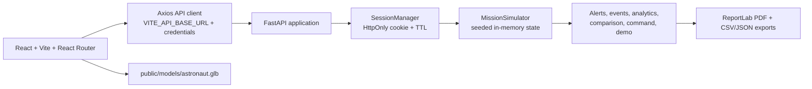

# AstroHealth Complete Pre-Deployment Code Audit

**Audit date:** 2026-11-14
**Repository:** `ANASS-AZYZ/AstroHealth`
**Scope:** Read-only source review, local execution checks, API/OpenAPI inspection, frontend route smoke testing, asset inspection, and dependency checks. The findings below are the original audit baseline; Phase 10 remediation status is recorded below.

## 1. Executive Summary

AstroHealth is a React/Vite frontend backed by a FastAPI/Pydantic Python service. The application contains the requested mission simulator, Digital Twin, analytics, Mission Intelligence, Mission Command Center, Guided Demo, exports, and PDF reports. The source backend now creates per-browser in-memory sessions, but those sessions remain process-local and are lost on restart or instance replacement.

The implemented prototype is suitable for a controlled local or single-process demonstration. It is **not approved for public deployment** until the target deployment is explicitly constrained to the supported single-process model (or shared persistence is added), remaining asset verification is recorded, and production smoke tests are run against the deployed HTTPS origins.

### Final readiness verdict: **BLOCKED**

### Summary counts

| Classification | Count |
|---|---:|
| Verified working feature areas | 12 |
| Failed checks | 2 |
| Not implemented / unavailable checks | 2 |
| Not tested in this audit | 3 |
| Deployment blockers | 2 |

The verified feature-area count means the source, tests, and/or browser smoke evidence support the feature's presence and core path. It does not mean every production failure mode is covered.

### Phase 10 remediation status

The following baseline findings have been remediated and locally verified:

- **FE-001:** affected initial-load pages now render retryable error states instead of permanent loading screens.
- **FE-002:** legacy health endpoints now expose the session's MissionSimulator state and history; no independent live random stream remains.
- **FE-003:** Live Monitoring now labels its local-only control **Clear Chart**.
- **BE-002:** sessions have configurable TTL cleanup, a maximum capacity, optional least-recently-used eviction, and an explicit capacity error mode.
- **BE-004:** process-local limits cover session creation, state-changing routes, reports, and scenario comparisons. These are not a substitute for provider-level limits across workers.
- **Production configuration:** production startup rejects wildcard/non-HTTPS origins and insecure cross-site cookie settings.
- **Performance:** priority route components are lazy-loaded, and Digital Twin rendering caps device pixel ratio at 1.5.

The GLB provenance and CC BY 4.0 license are now documented in [`THIRD_PARTY_ASSETS.md`](THIRD_PARTY_ASSETS.md). Remaining launch blockers are the intentionally single-process architecture, final source/model correspondence evidence, and HTTPS smoke testing after an approved deployment.

## 2. Architecture Overview

### Inventory

| Area | Verified implementation |
|---|---|
| Frontend | React 19, Vite 8, React Router 7, Recharts, React Three Fiber/Drei, Axios |
| Backend | FastAPI 0.162.7, Uvicorn 0.54.0, Pydantic 2.14.3, ReportLab 5.1.0 in the project virtual environment |
| Python environment | `backend/.venv`; system Python does not contain FastAPI, so backend checks must use the project environment |
| State management | React local component state plus backend `SessionManager`; no Redux or external client store |
| Simulation | `MissionSimulator` with seeded `random.Random`, mission clock, bounded metrics, events, alerts, and history |
| Persistence | In-memory only; sessions expire and all state is lost on restart |
| 3D asset | `frontend/public/models/astronaut.glb`, 1,804,556 bytes; SHA-256 `B60CCCE157BBBDA177DEDA47E29BFF248E00765F757EBC9FE04E064E50F96046` |
| Configuration | `VITE_API_BASE_URL`, `ALLOWED_ORIGINS`, session cookie settings, and TTL |
| Deployment | `backend/Dockerfile`, `render.yaml`, Cloudflare Pages `_redirects`/`_headers`, GitHub Actions CI |
| Test framework | Backend `unittest`; no frontend test script; `pytest` is not installed |

The 12 declared application routes are registered in [`frontend/src/App.jsx`](../frontend/src/App.jsx#L61) through [`frontend/src/App.jsx`](../frontend/src/App.jsx#L72).

## 3. Verified Feature Inventory

| Feature | Route | Status | Evidence |
|---|---|---|---|
| Mission Overview | `/` | VERIFIED | Route exists and browser smoke rendered the main shell |
| Astronaut Health | `/astronaut-health` | VERIFIED | Route exists; consumes profile, Digital Twin state, and history |
| Live Monitoring | `/live-monitoring` | VERIFIED | Route exists; polling and pause controls are implemented |
| Risk Alerts | `/risk-alerts` | VERIFIED | Route exists; alert polling and acknowledgement are implemented |
| Mars Mission Simulator | `/mission-simulator` | VERIFIED | Start/pause/resume/reset, scenario, phase, speed, history, and charts are implemented |
| Astronaut Digital Twin | `/digital-twin` | VERIFIED locally | Canvas, GLB loading, markers, controls, fallback, and synchronized state rendered locally |
| AI Health Analytics | `/health-analytics` | VERIFIED as statistical analytics | Linear trend, rolling z-score anomaly detection, data quality, and explainable insights are implemented |
| Mission Intelligence | `/mission-intelligence` | VERIFIED | Readiness, events, comparison, PDF, CSV, and JSON controls are present |
| Mission Command Center | `/mission-command` | VERIFIED | Scenario actions, consequences, messages, events, reset, and after-action downloads are present |
| Guided Demo | `/guided-demo` | VERIFIED locally | Start, navigation, restart, exit, seeded preset, alert trigger, and restoration are implemented |
| Scientific Evidence | `/scientific-evidence` | VERIFIED | NASA reference links and simulation boundaries are displayed |
| About AstroHealth | `/about` | VERIFIED | Project purpose, architecture, limitations, and repository link are displayed |

## 4. Frontend Findings

### Verified

- All 12 routes rendered a `<main>` element and did not render the application 404 page in the temporary local Vite smoke run.
- The sidebar exposes all 12 routes in [`Sidebar.jsx`](../frontend/src/components/Sidebar.jsx#L4).
- API calls are centralized in [`api.js`](../frontend/src/services/api.js#L3), use `VITE_API_BASE_URL`, and send credentials.
- Loading states and user-facing error messages exist across the main pages.
- The Digital Twin has a GLB loading indicator, React error boundary, WebGL fallback, camera reset button, OrbitControls, and metric markers in [`AstronautVisualization.jsx`](../frontend/src/components/AstronautVisualization.jsx#L23).

### Findings

#### FE-001 — MEDIUM

- **File/line:** [`DigitalTwin.jsx`](../frontend/src/pages/DigitalTwin.jsx#L13), [`MissionCommand.jsx`](../frontend/src/pages/MissionCommand.jsx#L58), [`MissionIntelligence.jsx`](../frontend/src/pages/MissionIntelligence.jsx#L54), [`MissionSimulator.jsx`](../frontend/src/pages/MissionSimulator.jsx#L46), [`GuidedDemo.jsx`](../frontend/src/pages/GuidedDemo.jsx#L40)
- **Description:** Several pages return a permanent loading screen when their initial API request fails. The error state is set, but the error cannot be displayed because rendering returns before `PageFrame`.
- **Evidence:** Each page has an `if (!data) return <main className="loading-screen">...` branch while the catch handler only sets an error string.
- **Impact:** A backend outage, timeout, or expired deployment can appear as an infinite loading screen instead of a recoverable error with retry guidance.
- **Recommended fix:** Render the page shell with an explicit error/empty state after the first failed request and provide a retry control.

#### FE-002 — MEDIUM

- **File/line:** [`main.py`](../backend/main.py#L92), [`AstronautHealth.jsx`](../frontend/src/pages/AstronautHealth.jsx#L9)
- **Description:** Legacy live telemetry is generated by a separate per-session random stream, while Astronaut Health combines that history with the authoritative MissionSimulator current measurement.
- **Evidence:** `/api/health/live` uses `session.live_rng`; Astronaut Health reads `getDigitalTwin()` for current values and `getHealthHistory()` for charts.
- **Impact:** Current cards and historical charts can describe different simulated streams, which weakens the claim that all pages show one synchronized mission.
- **Recommended fix:** Either migrate the legacy telemetry pages to MissionSimulator history or label the legacy stream as a separate demonstration feed.

#### FE-003 — LOW

- **File/line:** [`useTelemetry.js`](../frontend/src/hooks/useTelemetry.js#L7), [`LiveMonitoring.jsx`](../frontend/src/pages/LiveMonitoring.jsx#L8)
- **Description:** The Live Monitoring Reset button clears only the local chart state; it does not reset backend mission state.
- **Impact:** Users may interpret Reset as a mission reset when it only resets the view.
- **Recommended fix:** Rename it to “Clear view” or connect it to an explicit backend reset action.

#### FE-004 — LOW

- **File/line:** [`AstronautVisualization.jsx`](../frontend/src/components/AstronautVisualization.jsx#L101)
- **Description:** The renderer allows DPR up to 2 on every device and the production bundle is large.
- **Impact:** Mobile and low-power devices may incur unnecessary GPU and memory cost.
- **Recommended fix:** Use a device-aware DPR cap and code-split the Digital Twin/analytics routes after baseline functionality is stable.

## 5. Backend Findings

### API inventory verified from `app.openapi()["paths"]`

| Method | Endpoint | Purpose | Status |
|---|---|---|---|
| GET | `/`, `/healthz`, `/api/healthcheck` | Service and health responses | VERIFIED |
| GET | `/api/astronaut`, `/api/health`, `/api/health/live`, `/api/health/history` | Profile and simulated telemetry | VERIFIED |
| GET | `/api/mission/state`, `/api/mission/history`, `/api/mission/scenarios`, `/api/mission/phases` | Mission state and metadata | VERIFIED |
| POST | `/api/mission/start`, `/pause`, `/resume`, `/reset`, `/scenario`, `/phase`, `/speed`, `/advance` | Mission controls | VERIFIED |
| GET | `/api/digital-twin` | Digital Twin state, alerts, predictions, insights | VERIFIED |
| GET | `/api/analytics/summary`, `/predictions`, `/anomalies`, `/analytics/insights`, `/insights` | Analytics and insights | VERIFIED |
| GET/POST | `/api/alerts`, `/api/alerts/{alert_id}/acknowledge` | Alert list and acknowledgement | VERIFIED |
| GET | `/api/mission/events`, `/api/mission/readiness` | Intelligence events and score | VERIFIED |
| POST | `/api/mission/compare` | Deterministic isolated scenario comparison | VERIFIED |
| GET | `/api/reports/mission-health` | ReportLab mission PDF | VERIFIED |
| GET | `/api/export/telemetry.csv`, `/telemetry.json`, `/events.json` | Data exports | VERIFIED |
| GET/POST | `/api/command/state`, `/scenarios`, `/actions`, `/events`, `/messages` | Command state and metadata | VERIFIED |
| POST | `/api/command/activate`, `/respond`, `/reset`, `/messages` | Command actions and messages | VERIFIED |
| GET | `/api/command/after-action.json`, `/after-action.pdf` | After-action downloads | VERIFIED |
| GET/POST | `/api/demo/status`, `/state`, `/start`, `/advance`, `/reset`, `/exit` | Guided Demo lifecycle | VERIFIED |

### Verified

- FastAPI imports successfully from `backend/.venv`.
- Request models validate scenario literals, action/message length, comparison tick bounds, and demo step bounds.
- Invalid scenario and invalid response action were previously verified as 422 and 400 respectively.
- `/api/healthcheck` and `/healthz` returned 200 in a fresh temporary backend on port 8001.
- Report and export endpoints use current session data and do not read unrelated local files.
- CSV export protection exists for formula-leading values.
- Production CORS is environment-driven and `allow_credentials=True` in [`main.py`](../backend/main.py#L18).

### Findings

#### BE-001 — HIGH

- **File/line:** [`session_service.py`](../backend/services/session_service.py#L32), [`deployment-guide.md`](deployment-guide.md#L7)
- **Description:** Session isolation is process-local. The session map is not shared across workers or instances, and all state is lost on restart, redeploy, or free-tier spin-down.
- **Evidence:** `SessionManager` stores sessions in a Python dictionary; deployment documentation explicitly requires a single process.
- **Impact:** Multi-worker or multi-instance deployment can create inconsistent sessions, and a restart destroys user history. This is incompatible with a durable public production service.
- **Recommended fix:** Keep one worker for the controlled demo or introduce shared persistence before supporting multiple workers/instances. Do not claim horizontal scalability with the current store.

#### BE-002 — MEDIUM

- **File/line:** [`session_service.py`](../backend/services/session_service.py#L50), [`main.py`](../backend/main.py#L30)
- **Description:** Session cleanup occurs only when another request enters `SessionManager.get`; there is no hard capacity limit or background cleanup.
- **Impact:** A high volume of new visitors can retain many session objects until subsequent requests arrive, increasing memory pressure.
- **Recommended fix:** Add a maximum session count/eviction policy and provider-level rate limiting before public exposure.

#### BE-003 — MEDIUM

- **File/line:** [`mission.py`](../backend/routers/mission.py#L10), [`analytics.py`](../backend/routers/analytics.py#L30), [`command.py`](../backend/routers/command.py#L16)
- **Description:** Most successful responses rely on inferred dictionaries/Pydantic objects rather than explicit response models.
- **Impact:** API schema drift can reach the frontend without an early server-side contract failure.
- **Recommended fix:** Add response models to stable public endpoints, especially mission state, command state, exports metadata, and report-related JSON.

#### BE-004 — HIGH

- **File/line:** [`mission.py`](../backend/routers/mission.py#L15), [`command.py`](../backend/routers/command.py#L26), [`demo.py`](../backend/routers/demo.py#L36)
- **Description:** Public state-changing endpoints have no authentication, rate limiting, or abuse controls.
- **Impact:** Anyone who can reach the service can repeatedly advance/reset scenarios, generate reports, or create session state. The prototype is educational, but public availability and resource usage can be abused.
- **Recommended fix:** Add provider/API rate limiting and, if the demo becomes public beyond a controlled showcase, add an access gate or signed session issuance.

## 6. Simulation Engine Audit

| Capability | Status | Evidence |
|---|---|---|
| Start/pause/resume/reset | VERIFIED | [`mission_simulator.py`](../backend/services/mission_simulator.py#L131) through [`mission_simulator.py`](../backend/services/mission_simulator.py#L159) |
| Scenario switching | VERIFIED | `set_scenario` records changes and updates effects |
| Simulation speed | VERIFIED | Speed is validated by the request model and used by frontend polling |
| Deterministic seed | VERIFIED | `Random(self._seed)` and snapshot/restore |
| Mission clock | VERIFIED | Tick and elapsed hours advance only through controlled operations |
| Telemetry history | VERIFIED | Session simulator history and bounded live-history stream |
| Event history | VERIFIED | Session event store; comparison uses `track_events=False` |
| Scenario comparison | VERIFIED | Isolated seeded simulator instances with common baseline |
| Shared authoritative state | PARTIAL | Mission Intelligence, Command, Digital Twin, alerts, and reports share the session simulator; legacy Live Monitoring uses a separate stream |

No conflicting loop was found inside the MissionSimulator itself. Frontend polling is page-scoped and cleaned up on unmount, but the legacy telemetry stream is a separate data source.

## 7. Digital Twin 3D Audit

| Check | Status | Evidence |
|---|---|---|
| GLB exists | VERIFIED | 1,804,556-byte file at `frontend/public/models/astronaut.glb` |
| Public URL | VERIFIED locally | `/models/astronaut.glb` is used by `useGLTF` |
| Canvas/model render | VERIFIED locally | Browser rendered the canvas and astronaut view |
| Textures | NOT FULLY TESTED | No automated texture/material assertion was executed |
| Rotation/zoom | VERIFIED by implementation | OrbitControls enables damping, rotation, and distance limits |
| Reset camera | VERIFIED by implementation | `controls.current?.reset()` is wired |
| Health markers | VERIFIED by implementation | Marker groups and metric selection are wired |
| Loading/fallback | VERIFIED by implementation | `Suspense`, `useProgress`, error boundary, and WebGL fallback |
| Size/performance | VERIFIED for size; NEEDS ATTENTION for performance | 1.8 MB is reasonable for a demo, but DPR 2 and bundle size require device testing |
| Redistribution license | VERIFIED WITH FOLLOW-UP | Jungle Jim attribution, Sketchfab source, and CC BY 4.0 are documented; source/model correspondence and future-derivative tracking remain release checks |

The audit does not claim photorealism. The model was visually rendered locally, but no visual quality benchmark was performed.

## 8. Analytics Audit

AstroHealth does **not** contain a trained machine-learning model. The “AI Health Analytics” label is a product/UI label for explainable statistical prototype analytics.

| Capability | Implementation | Status |
|---|---|---|
| Data source | Session MissionSimulator history | VERIFIED |
| Feature extraction | Metric-specific numeric filtering with finite-value checks | VERIFIED |
| Forecasting | Moving-window linear trend extrapolation | VERIFIED |
| Anomaly detection | Rolling z-score with minimum observations and zero-variance guard | VERIFIED |
| Model training | None found | NOT IMPLEMENTED |
| Missing data | Insufficient-data responses and no fabricated prediction | VERIFIED |
| Limitations | Disclaimers identify experimental/statistical/non-clinical output | VERIFIED |

Evidence is in [`prediction_engine.py`](../backend/services/prediction_engine.py#L25), [`anomaly_detector.py`](../backend/services/anomaly_detector.py#L7), and [`HealthAnalytics.jsx`](../frontend/src/pages/HealthAnalytics.jsx#L59).

## 9. Mission Intelligence Audit

- **Readiness Score:** VERIFIED. Weights and formula are explicit in [`readiness_service.py`](../backend/services/readiness_service.py#L4); missing-data behavior and limitations are returned.
- **Event Timeline:** VERIFIED. Events have IDs, event type, description, mission timestamp, UTC timestamp, scenario, and optional metric.
- **Scenario Comparison:** VERIFIED. Isolated runs use the current session seed and the same baseline/ticks.
- **PDF report:** VERIFIED by implementation and prior report generation smoke; generated with ReportLab from session state.
- **CSV export:** VERIFIED; headers are explicit and formula-leading strings are escaped.
- **JSON export:** VERIFIED; metadata contains seed/scenario/phase and current events/alerts.

No hardcoded report telemetry or fake event history was found in the backend services reviewed.

## 10. Mission Command Center Audit

| Capability | Status |
|---|---|
| Six emergency scenarios | VERIFIED |
| Context-specific response actions | VERIFIED |
| Explainable before/after consequences | VERIFIED |
| Bounded response effects | VERIFIED |
| Seeded/deterministic simulator behavior | VERIFIED |
| Mission-clock communication delay | VERIFIED |
| Event logging | VERIFIED |
| Digital Twin and alert synchronization | VERIFIED through shared session simulator |
| After-action JSON/PDF | VERIFIED |
| Reversible reset | VERIFIED |

Response effects are explicit additive values in [`command_service.py`](../backend/services/command_service.py#L16), and state mutation is delegated to the session simulator.

## 11. Guided Demo Audit

| Capability | Status |
|---|---|
| Start Demo | VERIFIED |
| Next Step | VERIFIED |
| Previous Step | VERIFIED as step navigation |
| Restart Demo | VERIFIED |
| Exit Demo | VERIFIED |
| Seeded scenario/alert preset | VERIFIED |
| Snapshot and restoration | VERIFIED by unit tests |
| Reproducibility | VERIFIED by unit tests |
| Normal-session protection | VERIFIED within one browser session; limited by process-local storage |

Previous changes the walkthrough index only; it does not reverse mission time. This is documented in the existing test report and is not a hidden state mutation.

## 12. Security Audit

### Verified

- No secrets or API keys were found in source/configuration review.
- `.env` files are ignored and example files contain placeholders.
- CORS is not wildcarded in the source; production origin is environment-configured.
- Session IDs use `secrets.token_urlsafe(32)` and are stored in HttpOnly cookies.
- Pydantic validates public request shapes.
- No upload endpoint, shell execution endpoint, or arbitrary file export endpoint was found.
- Health endpoints expose only status/service strings.
- Scientific disclaimers state that measurements are simulated and non-clinical.
- `npm audit --omit=dev` completed with **0 vulnerabilities**.

### Findings

#### SEC-001 — RESOLVED WITH FOLLOW-UP

- **File/line:** [`THIRD_PARTY_ASSETS.md`](THIRD_PARTY_ASSETS.md), [`ASSET_LICENSE_REQUIRED.md`](ASSET_LICENSE_REQUIRED.md)
- **Description:** The model provenance and CC BY 4.0 attribution are documented.
- **Evidence:** “Astronaut by Jungle Jim” by Jungle Jim is linked to its Sketchfab source and CC BY 4.0 license. The original GLB is preserved and runtime-only presentation changes are recorded.
- **Impact:** The former unknown-license blocker is reduced; source/model correspondence and future derivative tracking remain release checks.
- **Recommended fix:** Retain source correspondence evidence and preserve the attribution in any public release.

#### SEC-002 — HIGH

- **File/line:** [`session_service.py`](../backend/services/session_service.py#L32)
- **Description:** In-memory sessions are not shared across workers/instances.
- **Evidence:** The authoritative session registry is a process-local dictionary.
- **Impact:** A deployment with more than one worker can route a browser to different mission states; restarts erase data.
- **Recommended fix:** Use one worker for the explicitly limited demo or add shared storage before scaling.

#### SEC-003 — HIGH

- **File/line:** [`mission.py`](../backend/routers/mission.py#L15), [`command.py`](../backend/routers/command.py#L26)
- **Description:** State-changing endpoints are unauthenticated and have no rate limiting.
- **Impact:** Public users can consume CPU/memory and repeatedly mutate their own session; operational availability is not protected.
- **Recommended fix:** Add edge/provider rate limits and an access-control mechanism for any public launch beyond a supervised demo.

#### SEC-004 — MEDIUM

- **File/line:** [`session_service.py`](../backend/services/session_service.py#L74), [`render.yaml`](../render.yaml#L9)
- **Description:** Secure cross-site cookie behavior depends on deployment environment variables.
- **Evidence:** Local defaults are `secure=false` and `samesite=lax`; Render configuration changes these to Secure/None.
- **Impact:** A misconfigured deployment can fail cross-site cookies or transmit session cookies without the intended secure flag.
- **Recommended fix:** Add a startup configuration check that refuses production mode when HTTPS cookie settings are inconsistent with the configured deployment.

## 13. Performance Audit

### Measured

- Frontend production build completed successfully.
- Minified JavaScript bundle: approximately **1,812.63 kB**, gzip approximately **510.69 kB**.
- GLB size: **1.8 MB**.
- Vite emitted a chunk-size warning for the main bundle.
- Browser emitted Three.js warnings for deprecated `THREE.Clock` and removed `PCFSoftShadowMap`.
- Polling intervals are 1 second for running mission simulation, 3 seconds for Digital Twin/analytics/intelligence/command, and 5 seconds for live telemetry/alerts.

### Not measured

- Real production API latency, cold-start time, CPU, memory, or concurrent-user capacity.
- Mobile GPU performance and texture/material fidelity.
- Provider bandwidth and monthly cost under real traffic.

### Findings

#### PERF-001 — MEDIUM

- **File/line:** [`App.jsx`](../frontend/src/App.jsx#L1), [`package.json`](../frontend/package.json#L1)
- **Description:** The initial JS bundle is approximately 1.8 MB minified and 510.69 kB gzip.
- **Impact:** Slow first load on mobile or weak networks.
- **Recommended fix:** Lazy-load route modules and isolate the Digital Twin/visualization chunk; remeasure before launch.

#### PERF-002 — LOW

- **File/line:** [`AstronautVisualization.jsx`](../frontend/src/components/AstronautVisualization.jsx#L101)
- **Description:** DPR can reach 2 and Three.js emits compatibility warnings.
- **Impact:** Extra GPU work and future library compatibility risk.
- **Recommended fix:** Cap DPR based on device capability and replace deprecated renderer/shadow configuration during a focused UI maintenance change.

## 14. Scientific Accuracy

- NASA links are presented as research context, not as application models or endorsements.
- Heart rate is labeled BPM; oxygen saturation is labeled `%`; sleep is hours; index values are dimensionless; radiation is explicitly a dose-rate indicator in `mSv/day`.
- Radiation scenarios state that no immediate medical symptom is inferred.
- Alert thresholds are configurable demonstrations, not NASA medical standards.
- Forecasting is a moving-window linear statistical estimate, not trained AI or a validated physiology model.
- Readiness Score formula, weights, categories, missing-data behavior, and limitations are returned by the API.
- The application repeatedly states that data is simulated, experimental, non-clinical, and not operational guidance.

No claim of NASA endorsement, real astronaut telemetry, medical diagnosis, or validated prediction was found in the reviewed application copy.

## 15. Test Results

### Executed successfully

| Test | Result |
|---|---|
| `backend\.venv\Scripts\python.exe -m compileall -q models routers services main.py` | PASSED |
| `backend\.venv\Scripts\python.exe -m unittest discover -s tests -v` | PASSED: 17 tests |
| `backend\.venv\Scripts\python.exe -c "from main import app ..."` | PASSED; app imported and health route registered |
| Temporary backend `/api/healthcheck`, `/healthz`, live telemetry, CORS, and session-cookie smoke | PASSED on port 8001 |
| `npm.cmd run lint` | PASSED |
| `npm.cmd run build` | PASSED with bundle-size warning |
| `npm.cmd audit --omit=dev` | PASSED: 0 vulnerabilities |
| Temporary Vite browser route smoke for all 12 routes | PASSED: no application 404 page |
| Digital Twin local browser render | PASSED locally; console warnings remain |

### Failed or unavailable

| Test | Result | Exact reason |
|---|---|---|
| `python -m pytest -q` | FAILED/UNAVAILABLE | `No module named pytest` in `backend/.venv` |
| `npm.cmd test -- --runInBand` | FAILED/UNAVAILABLE | `Missing script: "test"` |
| `pip-audit -r requirements.txt` | NOT TESTED | `pip-audit.exe` is not installed in the project environment |
| Production HTTPS smoke | NOT TESTED | No public deployment exists and no cloud resource was created |
| Formal automated Playwright test suite | NOT IMPLEMENTED | Browser smoke was run interactively; no committed Playwright suite exists |

During the browser audit, the shared frontend was initially unavailable on port 5173. After starting a temporary Vite server, all routes rendered. The browser also recorded CORS failures against an existing backend process on port 8000; the current source was separately validated on port 8001 with correct CORS headers. This indicates a stale/mismatched local process, not a clean production smoke pass.

## 16. Deployment Blockers

1. **MEDIUM — GLB release evidence requires final confirmation.** Attribution and CC BY 4.0 are documented; retain source correspondence evidence before launch.
2. **HIGH — State architecture is single-process only.** Do not deploy multiple workers/instances without shared session persistence.
3. **MEDIUM — Process-local abuse controls are not distributed.** Keep provider/API rate limits enabled before exposing unauthenticated state-changing endpoints.
4. **MEDIUM — Initial-load resilience requires browser verification.** Retry/error states are implemented and need production smoke confirmation.
5. **MEDIUM — Production HTTPS smoke is absent.** It cannot be marked verified until an approved deployment exists.

## 17. Recommended Repair Plan

### P0 — Required before approval

1. Preserve the documented GLB attribution and collect source/model correspondence evidence.
2. Confirm a single-worker deployment configuration or implement shared session persistence.
3. Configure exact HTTPS CORS origin and Secure/SameSite cookie settings.
4. Add edge/API rate limiting.

### P1 — Strongly recommended before public demo

1. Replace infinite loading branches with retryable error states.
2. Unify legacy live telemetry with MissionSimulator history or clearly separate the product language.
3. Run `pip-audit` and the GitHub Actions workflow in a clean environment.
4. Execute production HTTPS smoke tests in two browser profiles.

### P2 — Quality/performance improvements

1. Code-split the frontend and Digital Twin.
2. Resolve Three.js warnings.
3. Add a committed browser smoke suite and frontend component tests.
4. Add explicit response models for stable API contracts.

## 18. Final Verdict

**BLOCKED — NOT READY FOR PUBLIC DEPLOYMENT**

The core educational application is functional and the local test/build evidence is strong. The verdict remains blocked by the explicit single-process limitation of the current in-memory session architecture and the need for approved HTTPS smoke testing; the former unknown asset-license finding now has documented evidence and follow-up checks. No deployment, commit, push, paid service, or cloud resource was created during this audit.
